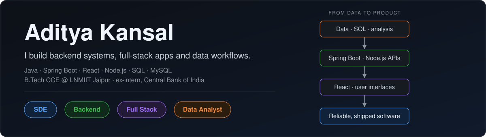

  

  <a href="#featured-systems">Featured Systems</a> &nbsp;•&nbsp;
  <a href="#engineering-experience">Experience</a> &nbsp;•&nbsp;
  <a href="#technical-arsenal">Technical Stack</a> &nbsp;•&nbsp;
  <a href="#leadership--initiatives">Leadership</a> &nbsp;•&nbsp;
  <a href="#contact">Contact</a>

---

### About Me

I am a backend and full-stack software engineer specializing in systems that process high-volume, validation-heavy workflows into fast, auditable data. My primary foundation is **Java & Spring Boot** for transactional, rule-heavy backend architectures, alongside **Node.js, TypeScript, and React** for complete web systems.

Rather than treating databases as passive storage, I design schemas around strict relational constraints, eliminate query bottlenecks ($N+1$ loops, unindexed joins, memory bloat), and enforce explicit state machines so records can never enter invalid business states.

---

## Featured Systems

### 1. [Vartalaap Banking Portal](https://github.com/Kansal26/spring-boot-bank-portal)
**Stack:** Java 17, Spring Boot, Spring Security, Spring Data JPA / Hibernate, MySQL, Thymeleaf

An enterprise banking operations portal built to handle high-throughput public sector scheme registrations (such as PMJJBY, PMSBY, APY, and PMMY). The platform enforces strict regulatory compliance, segregates operator roles, and aggregates real-time branch performance metrics.

* **Deterministic Maker-Checker State Machine:** Financial enrollment forms must pass through an explicit, unidirectional approval lifecycle (`Pending` $\rightarrow$ `Approved` / `Rejected`). State transitions are gated by role checks at the service layer, preventing unauthorized modifications, race conditions, or skips in the verification sequence.
* **Multi-Tier Scheme Validation Engine:** Created validation pipelines verifying customer eligibility criteria (age bands, KYC compliance status, existing enrollment checks, and account linkage) before database persistence, cutting down downstream reconciliation errors.
* **Optimized Branch Analytics & Aggregation:** Designed repository queries to aggregate scheme enrollment counts and performance across regional branches. Rewrote unindexed filtering to leverage targeted composite indexes and indexed foreign keys, preventing full table scans across tens of thousands of records.
* **Security & Environment Isolation:** Secured endpoints using Spring Security with CSRF protection, session management, and role-based access control (`ROLE_MAKER`, `ROLE_CHECKER`, `ROLE_ADMIN`). Implemented clean configuration decoupling for local H2 development and production MySQL/PostgreSQL deployment.

---

### 2. [TableMind](https://github.com/Kansal26/table-mind-magic)
**Stack:** React 18, TypeScript, TanStack Router, Tailwind CSS, PostgreSQL, Supabase, Web Speech API

A contactless, real-time restaurant ordering and dining system featuring allergen-aware interactive digital menus, voice-driven ordering, and live administrative kitchen dispatching.

* **Multi-Tenant Data Isolation with PostgreSQL RLS:** Implemented Postgres Row Level Security (RLS) policies at the database layer. Every query is scoped to the authenticated restaurant tenant and active table session, ensuring strict tenant isolation where cross-tenant data leaks are mathematically impossible at the database engine level.
* **Relational Schema with Cascading Integrity:** Structured schema relationships with strict foreign key constraints and `ON DELETE CASCADE` rules across orders, items, modifier groups, and customer feedback—preventing orphaned records and stale references during active service hours.
* **Typed Client Architecture:** Replaced traditional client routing with TanStack Router for end-to-end type safety across search parameters (table IDs, category filters, allergen tags). This eliminated runtime route parsing bugs and state desynchronization.
* **Voice-Assisted Discovery:** Integrated the Web Speech recognition API paired with fuzzy string matching against the restaurant's active menu catalog, allowing hands-free voice discovery and accessibility.

---

### 3. [Faculty Appraisal System](https://github.com/Sanskriti0805/Faculty_appraisal_system)
**Stack:** React 18, Node.js, Express, MySQL 8 (InnoDB), Puppeteer, Node-cache, Nodemailer

An end-to-end academic performance management and evaluation platform developed for The LNM Institute of Information Technology (LNMIIT). It digitizes the annual evaluation lifecycle across 4 distinct organizational roles: Faculty, Department Heads, Dean of Faculty Affairs (DoFA), and the DoFA Administrative Office.

* **N+1 Query Resolution (~95% Latency Drop):** The legacy publication and editor ingestion endpoint performed nested database loops per record ($1 + 2N$ queries). Refactored the data-fetching layer into 3 consolidated SQL `JOIN` queries paired with an in-memory transformation pipeline via `Array.prototype.reduce()`, dropping database round-trips by ~95% for heavy faculty profiles.
* **Hybrid EAV & JSON Schema Design:** Because academic evaluation rubrics and submission fields change across appraisal cycles, the database pairs normalized relational tables with structured JSON columns. This Entity-Attribute-Value (EAV) flexibility allows administrators to dynamically configure custom evaluation criteria without running intrusive `ALTER TABLE` DDL migrations.
* **Automated Rubric Scoring Engine:** Form submissions trigger immediate calculation against pre-configured departmental rubrics (API points, research impact factors, teaching loads), populating provisional scores and grading sheets instantly upon submission.
* **Headless Server-Side Document Generation:** Implemented server-side PDF generation using headless Puppeteer with customized CSS print media rules. Renders comprehensive, print-ready institutional records with dynamic page numbering, headers, footers, and official LNMIIT branding.
* **Lifecycle State & Concurrency Controls:** Enforced a submission pipeline (`Draft` $\rightarrow$ `Submitted` $\rightarrow$ `Under Review` $\rightarrow$ `Approved` / `Sent Back`) backed by submission locks and session timeline windows to prevent modifications once formal review cycles commence.

---

## Engineering Experience

#### **Central Bank of India** | *IT & Data Analyst Intern*
*May 2025 – July 2025*

* Engineered a Java and Spring Boot processing pipeline to automate enrollment verification for government-mandated financial inclusion schemes (APY, PMJJBY, PMSBY), reducing manual processing bottlenecks by **40%**.
* Wrote server-side validation layers cross-referencing customer demographic constraints, account validity, and duplicate registrations prior to ledger recording.
* Tuned MySQL transaction status queries across high-volume branch submission logs, reducing query execution times during peak reporting windows and significantly cutting down manual intervention requirements for branch officers.

---

## Technical Arsenal

| Category | Technologies & Tools |
|---|---|
| **Languages** | Java, JavaScript (ES6+), TypeScript, C++, SQL, HTML5, CSS3 |
| **Backend & Frameworks** | Spring Boot, Spring Security, Spring Data JPA / Hibernate, Node.js, Express.js, REST APIs |
| **Databases & Data Modeling** | MySQL, PostgreSQL (Supabase), Relational Schema Design, Query Optimization, Row Level Security (RLS), Indexing |
| **Frontend Engineering** | React, TanStack Router, Vite, Tailwind CSS, Responsive Web Design |
| **Tooling & Infrastructure** | Git, GitHub, Puppeteer, Docker (containerization), Maven, npm/yarn, Postman |
| **Architectural Concepts** | Role-Based Access Control (RBAC), Maker-Checker Workflows, Entity-Attribute-Value (EAV) Modeling, Caching Strategies |

---

## Leadership & Initiatives

* **Coordinator, Counselling & Guidance Cell (LNMIIT)** *(Mar 2025 – Aug 2026)*  
  Led a 55-member student-mentor team managing campus-wide mentoring initiatives, orientation workflows, and support programs for over 650 participants.
* **Coordinator, LNMIIT Debate Society** *(2025 – 2026)*  
  Organized LNMIIT Model United Nations (MUN) 2026, directing operations and committee logistics for 150+ delegates across 5 simultaneous committees.
* **Academic Benchmark**  
  JEE Main 2023: **96.45 Percentile**.

---

## Contact

  
  &nbsp;
  
  &nbsp;
  

